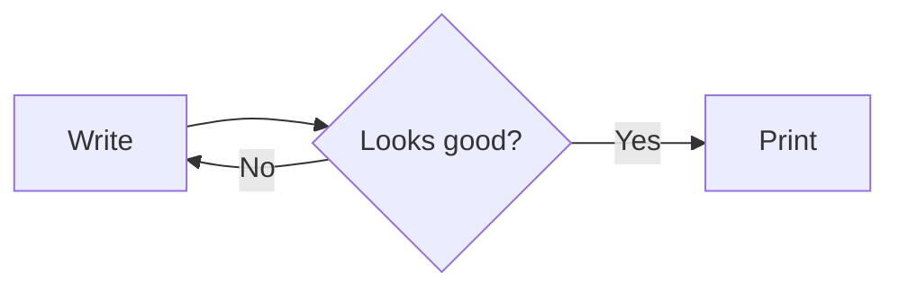

# Field notes on paper

Paper has rules that screens do not. A page ends, and whatever is on it has to make sense until the reader turns it. Headings belong with the text they introduce, listings carry on where they stopped, and a table keeps its column names in view. Paper has rules that screens do not. A page ends, and whatever is on it has to make sense until the reader turns it. Headings belong with the text they introduce, listings carry on where they stopped, and a table keeps its column names in view.

## Introduction

Paper has rules that screens do not. A page ends, and whatever is on it has to make sense until the reader turns it. Headings belong with the text they introduce, listings carry on where they stopped, and a table keeps its column names in view. Paper has rules that screens do not. A page ends, and whatever is on it has to make sense until the reader turns it. Headings belong with the text they introduce, listings carry on where they stopped, and a table keeps its column names in view. Paper has rules that screens do not. A page ends, and whatever is on it has to make sense until the reader turns it. Headings belong with the text they introduce, listings carry on where they stopped, and a table keeps its column names in view. [^paper]

Inline math sits in the line, $e^{i\pi} + 1 = 0$, and display math stands apart:

$$
\sum_{n=1}^{\infty} \frac{1}{n^2} = \frac{\pi^2}{6}
$$

> [!NOTE]
> Callouts keep their tint on paper.

A link that is far too long to fit on one line of a printed page: https://example.com/a/very/long/path/that/keeps/going/and/going/until/it/has/to/wrap/somewhere/sensible

## A long listing

```ts
const line001 = 'line 001' // keeps the listing long enough to cross pages
const line002 = 'line 002' // keeps the listing long enough to cross pages
const line003 = 'line 003' // keeps the listing long enough to cross pages
const line004 = 'line 004' // keeps the listing long enough to cross pages
const line005 = 'line 005' // keeps the listing long enough to cross pages
const line006 = 'line 006' // keeps the listing long enough to cross pages
const line007 = 'line 007' // keeps the listing long enough to cross pages
const line008 = 'line 008' // keeps the listing long enough to cross pages
const line009 = 'line 009' // keeps the listing long enough to cross pages
const line010 = 'line 010' // keeps the listing long enough to cross pages
const line011 = 'line 011' // keeps the listing long enough to cross pages
const line012 = 'line 012' // keeps the listing long enough to cross pages
const line013 = 'line 013' // keeps the listing long enough to cross pages
const line014 = 'line 014' // keeps the listing long enough to cross pages
const line015 = 'line 015' // keeps the listing long enough to cross pages
const line016 = 'line 016' // keeps the listing long enough to cross pages
const line017 = 'line 017' // keeps the listing long enough to cross pages
const line018 = 'line 018' // keeps the listing long enough to cross pages
const line019 = 'line 019' // keeps the listing long enough to cross pages
const line020 = 'line 020' // keeps the listing long enough to cross pages
const line021 = 'line 021' // keeps the listing long enough to cross pages
const line022 = 'line 022' // keeps the listing long enough to cross pages
const line023 = 'line 023' // keeps the listing long enough to cross pages
const line024 = 'line 024' // keeps the listing long enough to cross pages
const line025 = 'line 025' // keeps the listing long enough to cross pages
const line026 = 'line 026' // keeps the listing long enough to cross pages
const line027 = 'line 027' // keeps the listing long enough to cross pages
const line028 = 'line 028' // keeps the listing long enough to cross pages
const line029 = 'line 029' // keeps the listing long enough to cross pages
const line030 = 'line 030' // keeps the listing long enough to cross pages
const line031 = 'line 031' // keeps the listing long enough to cross pages
const line032 = 'line 032' // keeps the listing long enough to cross pages
const line033 = 'line 033' // keeps the listing long enough to cross pages
const line034 = 'line 034' // keeps the listing long enough to cross pages
const line035 = 'line 035' // keeps the listing long enough to cross pages
const line036 = 'line 036' // keeps the listing long enough to cross pages
const line037 = 'line 037' // keeps the listing long enough to cross pages
const line038 = 'line 038' // keeps the listing long enough to cross pages
const line039 = 'line 039' // keeps the listing long enough to cross pages
const line040 = 'line 040' // keeps the listing long enough to cross pages
const line041 = 'line 041' // keeps the listing long enough to cross pages
const line042 = 'line 042' // keeps the listing long enough to cross pages
const line043 = 'line 043' // keeps the listing long enough to cross pages
const line044 = 'line 044' // keeps the listing long enough to cross pages
const line045 = 'line 045' // keeps the listing long enough to cross pages
const line046 = 'line 046' // keeps the listing long enough to cross pages
const line047 = 'line 047' // keeps the listing long enough to cross pages
const line048 = 'line 048' // keeps the listing long enough to cross pages
const line049 = 'line 049' // keeps the listing long enough to cross pages
const line050 = 'line 050' // keeps the listing long enough to cross pages
const line051 = 'line 051' // keeps the listing long enough to cross pages
const line052 = 'line 052' // keeps the listing long enough to cross pages
const line053 = 'line 053' // keeps the listing long enough to cross pages
const line054 = 'line 054' // keeps the listing long enough to cross pages
const line055 = 'line 055' // keeps the listing long enough to cross pages
const line056 = 'line 056' // keeps the listing long enough to cross pages
const line057 = 'line 057' // keeps the listing long enough to cross pages
const line058 = 'line 058' // keeps the listing long enough to cross pages
const line059 = 'line 059' // keeps the listing long enough to cross pages
const line060 = 'line 060' // keeps the listing long enough to cross pages
const line061 = 'line 061' // keeps the listing long enough to cross pages
const line062 = 'line 062' // keeps the listing long enough to cross pages
const line063 = 'line 063' // keeps the listing long enough to cross pages
const line064 = 'line 064' // keeps the listing long enough to cross pages
const line065 = 'line 065' // keeps the listing long enough to cross pages
const line066 = 'line 066' // keeps the listing long enough to cross pages
const line067 = 'line 067' // keeps the listing long enough to cross pages
const line068 = 'line 068' // keeps the listing long enough to cross pages
const line069 = 'line 069' // keeps the listing long enough to cross pages
const line070 = 'line 070' // keeps the listing long enough to cross pages
const line071 = 'line 071' // keeps the listing long enough to cross pages
const line072 = 'line 072' // keeps the listing long enough to cross pages
const line073 = 'line 073' // keeps the listing long enough to cross pages
const line074 = 'line 074' // keeps the listing long enough to cross pages
const line075 = 'line 075' // keeps the listing long enough to cross pages
const line076 = 'line 076' // keeps the listing long enough to cross pages
const line077 = 'line 077' // keeps the listing long enough to cross pages
const line078 = 'line 078' // keeps the listing long enough to cross pages
const line079 = 'line 079' // keeps the listing long enough to cross pages
const line080 = 'line 080' // keeps the listing long enough to cross pages
const line081 = 'line 081' // keeps the listing long enough to cross pages
const line082 = 'line 082' // keeps the listing long enough to cross pages
const line083 = 'line 083' // keeps the listing long enough to cross pages
const line084 = 'line 084' // keeps the listing long enough to cross pages
const line085 = 'line 085' // keeps the listing long enough to cross pages
const line086 = 'line 086' // keeps the listing long enough to cross pages
const line087 = 'line 087' // keeps the listing long enough to cross pages
const line088 = 'line 088' // keeps the listing long enough to cross pages
const line089 = 'line 089' // keeps the listing long enough to cross pages
const line090 = 'line 090' // keeps the listing long enough to cross pages
const line091 = 'line 091' // keeps the listing long enough to cross pages
const line092 = 'line 092' // keeps the listing long enough to cross pages
const line093 = 'line 093' // keeps the listing long enough to cross pages
const line094 = 'line 094' // keeps the listing long enough to cross pages
const line095 = 'line 095' // keeps the listing long enough to cross pages
const line096 = 'line 096' // keeps the listing long enough to cross pages
const line097 = 'line 097' // keeps the listing long enough to cross pages
const line098 = 'line 098' // keeps the listing long enough to cross pages
const line099 = 'line 099' // keeps the listing long enough to cross pages
const line100 = 'line 100' // keeps the listing long enough to cross pages
const line101 = 'line 101' // keeps the listing long enough to cross pages
const line102 = 'line 102' // keeps the listing long enough to cross pages
const line103 = 'line 103' // keeps the listing long enough to cross pages
const line104 = 'line 104' // keeps the listing long enough to cross pages
const line105 = 'line 105' // keeps the listing long enough to cross pages
const line106 = 'line 106' // keeps the listing long enough to cross pages
const line107 = 'line 107' // keeps the listing long enough to cross pages
const line108 = 'line 108' // keeps the listing long enough to cross pages
const line109 = 'line 109' // keeps the listing long enough to cross pages
const line110 = 'line 110' // keeps the listing long enough to cross pages
const line111 = 'line 111' // keeps the listing long enough to cross pages
const line112 = 'line 112' // keeps the listing long enough to cross pages
const line113 = 'line 113' // keeps the listing long enough to cross pages
const line114 = 'line 114' // keeps the listing long enough to cross pages
const line115 = 'line 115' // keeps the listing long enough to cross pages
const line116 = 'line 116' // keeps the listing long enough to cross pages
const line117 = 'line 117' // keeps the listing long enough to cross pages
const line118 = 'line 118' // keeps the listing long enough to cross pages
const line119 = 'line 119' // keeps the listing long enough to cross pages
const line120 = 'line 120' // keeps the listing long enough to cross pages
const line121 = 'line 121' // keeps the listing long enough to cross pages
const line122 = 'line 122' // keeps the listing long enough to cross pages
const line123 = 'line 123' // keeps the listing long enough to cross pages
const line124 = 'line 124' // keeps the listing long enough to cross pages
const line125 = 'line 125' // keeps the listing long enough to cross pages
const line126 = 'line 126' // keeps the listing long enough to cross pages
const line127 = 'line 127' // keeps the listing long enough to cross pages
const line128 = 'line 128' // keeps the listing long enough to cross pages
const line129 = 'line 129' // keeps the listing long enough to cross pages
const line130 = 'line 130' // keeps the listing long enough to cross pages
const line131 = 'line 131' // keeps the listing long enough to cross pages
const line132 = 'line 132' // keeps the listing long enough to cross pages
const line133 = 'line 133' // keeps the listing long enough to cross pages
const line134 = 'line 134' // keeps the listing long enough to cross pages
const line135 = 'line 135' // keeps the listing long enough to cross pages
const line136 = 'line 136' // keeps the listing long enough to cross pages
const line137 = 'line 137' // keeps the listing long enough to cross pages
const line138 = 'line 138' // keeps the listing long enough to cross pages
const line139 = 'line 139' // keeps the listing long enough to cross pages
const line140 = 'line 140' // keeps the listing long enough to cross pages
const line141 = 'line 141' // keeps the listing long enough to cross pages
const line142 = 'line 142' // keeps the listing long enough to cross pages
const line143 = 'line 143' // keeps the listing long enough to cross pages
const line144 = 'line 144' // keeps the listing long enough to cross pages
const line145 = 'line 145' // keeps the listing long enough to cross pages
const line146 = 'line 146' // keeps the listing long enough to cross pages
const line147 = 'line 147' // keeps the listing long enough to cross pages
const line148 = 'line 148' // keeps the listing long enough to cross pages
const line149 = 'line 149' // keeps the listing long enough to cross pages
const line150 = 'line 150' // keeps the listing long enough to cross pages
```

## A long table

| Region code | Quarter | Units | Shipped |
| ----------- | ------- | ----: | ------- |
| Row 001     | South   |    37 | yes     |
| Row 002     | East    |    74 | yes     |
| Row 003     | West    |   111 | no      |
| Row 004     | North   |   148 | yes     |
| Row 005     | South   |   185 | yes     |
| Row 006     | East    |   222 | no      |
| Row 007     | West    |   259 | yes     |
| Row 008     | North   |   296 | yes     |
| Row 009     | South   |   333 | no      |
| Row 010     | East    |   370 | yes     |
| Row 011     | West    |   407 | yes     |
| Row 012     | North   |   444 | no      |
| Row 013     | South   |   481 | yes     |
| Row 014     | East    |   518 | yes     |
| Row 015     | West    |   555 | no      |
| Row 016     | North   |   592 | yes     |
| Row 017     | South   |   629 | yes     |
| Row 018     | East    |   666 | no      |
| Row 019     | West    |   703 | yes     |
| Row 020     | North   |   740 | yes     |
| Row 021     | South   |   777 | no      |
| Row 022     | East    |   814 | yes     |
| Row 023     | West    |   851 | yes     |
| Row 024     | North   |   888 | no      |
| Row 025     | South   |   925 | yes     |
| Row 026     | East    |   962 | yes     |
| Row 027     | West    |   999 | no      |
| Row 028     | North   |    36 | yes     |
| Row 029     | South   |    73 | yes     |
| Row 030     | East    |   110 | no      |
| Row 031     | West    |   147 | yes     |
| Row 032     | North   |   184 | yes     |
| Row 033     | South   |   221 | no      |
| Row 034     | East    |   258 | yes     |
| Row 035     | West    |   295 | yes     |
| Row 036     | North   |   332 | no      |
| Row 037     | South   |   369 | yes     |
| Row 038     | East    |   406 | yes     |
| Row 039     | West    |   443 | no      |
| Row 040     | North   |   480 | yes     |
| Row 041     | South   |   517 | yes     |
| Row 042     | East    |   554 | no      |
| Row 043     | West    |   591 | yes     |
| Row 044     | North   |   628 | yes     |
| Row 045     | South   |   665 | no      |
| Row 046     | East    |   702 | yes     |
| Row 047     | West    |   739 | yes     |
| Row 048     | North   |   776 | no      |
| Row 049     | South   |   813 | yes     |
| Row 050     | East    |   850 | yes     |
| Row 051     | West    |   887 | no      |
| Row 052     | North   |   924 | yes     |
| Row 053     | South   |   961 | yes     |
| Row 054     | East    |   998 | no      |
| Row 055     | West    |    35 | yes     |
| Row 056     | North   |    72 | yes     |
| Row 057     | South   |   109 | no      |
| Row 058     | East    |   146 | yes     |
| Row 059     | West    |   183 | yes     |
| Row 060     | North   |   220 | no      |

## A wide table

| Alpha                                  | Beta              | Gamma            | Delta             | Epsilon              | Zeta       | Eta  | Theta          |
| -------------------------------------- | ----------------- | ---------------- | ----------------- | -------------------- | ---------- | ---- | -------------- |
| https://example.com/one/two/three/four | twelve characters | 3.14159265358979 | lorem ipsum dolor | sit amet consectetur | adipiscing | elit | sed do eiusmod |

## A diagram



## A tall image


## Before the break

Paper has rules that screens do not. A page ends, and whatever is on it has to make sense until the reader turns it. Headings belong with the text they introduce, listings carry on where they stopped, and a table keeps its column names in view.

<!-- pagebreak -->

## After the break

After the break, this paragraph starts a fresh page.

Paper has rules that screens do not. A page ends, and whatever is on it has to make sense until the reader turns it. Headings belong with the text they introduce, listings carry on where they stopped, and a table keeps its column names in view. Paper has rules that screens do not. A page ends, and whatever is on it has to make sense until the reader turns it. Headings belong with the text they introduce, listings carry on where they stopped, and a table keeps its column names in view.

[^paper]: Footnotes print as endnotes at the end of the document.
