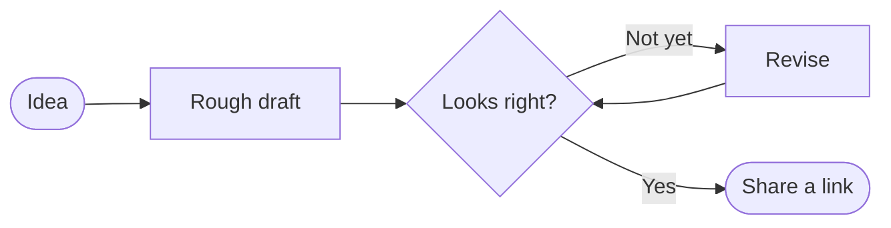

# A field guide to RenderMD

This page shows what RenderMD can render. Nothing leaves your browser unless you share it.

> [!TIP]
> Drag a `.md` file anywhere onto this page, paste a GitHub link with <kbd>⌘</kbd> <kbd>K</kbd> → _Open from URL_, or just start typing in the editor. Everything is saved locally as you go.


## Text formatting

Mix **bold**, _italic_, ~~struck~~ and <mark>highlighted</mark> text. Use `inline code` for terms like `useDeferredValue`, and footnotes when you need an aside.[^aside] Emoji shortcodes work too :sparkles:

Switch the **typeset** from the <kbd>Aa</kbd> menu — _Modern_, _Editorial_ or _Technical_. It changes the fonts and spacing of the whole document.

> The universe is made of stories, not of atoms.
>
> — Muriel Rukeyser

### Lists & tasks

1. Write the draft
2. Ask for feedback
   - from your team
   - from a few readers
3. Publish

Tick a box in the preview and the markdown updates itself:

- [x] Render GitHub Flavored Markdown
- [x] Render math, diagrams and 200+ languages
- [ ] Export to PDF
- [ ] Send a share link

## Code

```ts title="render.worker.ts"
// Parsing happens off the main thread, so the editor stays responsive.
self.onmessage = ({ data }: MessageEvent<RenderRequest>) => {
  const result = renderMarkdown(data.markdown, { stripPositions: true })
  self.postMessage({ id: data.id, ok: true, result })
}
```

```diff
- const html = await renderOnTheServer(markdown, { ads: true })
+ const html = renderInYourBrowser(markdown)
```

## Diagrams

Any [Mermaid](https://mermaid.js.org) diagram renders inline. Try the _Sketch_ look in the <kbd>Aa</kbd> menu for a hand-drawn style.



## Mathematics

Inline math sits within the text: $E = mc^2$, and $\nabla \times \mathbf{E} = -\frac{\partial \mathbf{B}}{\partial t}$.

Display math gets its own line:

$$
\int_{-\infty}^{\infty} e^{-x^2}\,dx = \sqrt{\pi}
$$

## Tables

| Action          |            Mac            |              Windows & Linux |
| :-------------- | :-----------------------: | ---------------------------: |
| Command palette | <kbd>⌘</kbd> <kbd>K</kbd> | <kbd>Ctrl</kbd> <kbd>K</kbd> |
| Open a file     | <kbd>⌘</kbd> <kbd>O</kbd> | <kbd>Ctrl</kbd> <kbd>O</kbd> |
| Save to disk    | <kbd>⌘</kbd> <kbd>S</kbd> | <kbd>Ctrl</kbd> <kbd>S</kbd> |
| **Bold**        | <kbd>⌘</kbd> <kbd>B</kbd> | <kbd>Ctrl</kbd> <kbd>B</kbd> |

## Callouts

> [!NOTE]
> GitHub-style alerts render as callouts.

> [!WARNING]
> Share links contain the whole document, compressed into the URL fragment — which is never sent to any server.

<details>
<summary>Raw HTML works too (safely sanitized)</summary>

RenderMD keeps the useful parts of HTML and strips anything that could run code.

</details>

---

[^aside]: Footnotes are collected at the end of the document.
